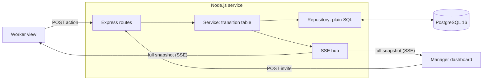
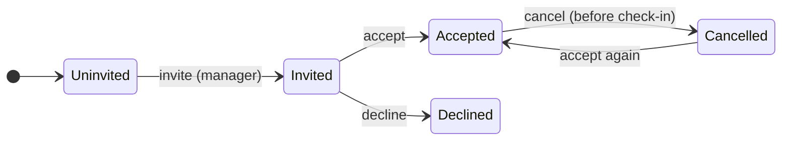

# Live Staffing Dashboard

[](https://github.com/Ibrahimkas68/oloodi-staffing-dashboard/actions/workflows/ci.yml)

An event manager needs three workers for one shift. Workers accept or decline invitations, then
check in and check out. The manager sees every change live, without refreshing.

- **Manager dashboard** at `/`: the shift, the three workers, their two statuses, live counts, and
  the invite button.
- **Worker view** at `/worker?worker=<id>`: one worker, only the actions that are allowed right now.
  Opening `/worker` without an id shows a name picker.
- Both views stay in sync through Server-Sent Events, show a live / reconnecting / offline badge, and
  catch up by themselves after a lost connection.

## Setup

You need Docker. Nothing else.

```bash
git clone https://github.com/Ibrahimkas68/oloodi-staffing-dashboard.git
cd oloodi-staffing-dashboard
docker compose up --build
```

Open <http://localhost:3000> (manager) and <http://localhost:3000/worker> (worker). Use two separate
windows or browser profiles: browsers allow only about six HTTP/1.1 connections per site, and each
view holds one live connection.

The first start creates the schema and the roles and loads the seed: one shift today, starting two
hours after the reset, three workers (Amina El Idrissi, Youssef Benali, Salma Haddad), nobody
invited. Later starts leave the data alone. Stop with `docker compose down` (data kept) or
`docker compose down -v` (data deleted).

Configuration, ports, the image, the e2e container and troubleshooting are in
[infra/README.md](infra/README.md). Every variable has a working default; see
[.env.example](.env.example).

### Running from source

For work on the code you need Node 22 and the database container:

```bash
cp .env.example .env
docker compose up -d db
npm ci
npm run build -w @staffing/web
npm run start -w @staffing/server     # http://localhost:3000
```

`npm run dev` (hot reload) is not available yet: its script is a pending task (T078).

## Reset

With the stack running and a `.env` file:

```bash
npm run db:reset
```

This drops and recreates the schema and loads the seed again, so the shift starts two hours from now.
`docker compose down -v` also works, at the cost of stopping the stack.

## Demo steps (2 minutes)

1. Open the manager in one window and the worker view in another, with Amina selected.
2. Manager: invite Amina. The worker view changes without a refresh.
3. Worker: accept, then check in, then check out. The manager's statuses, counts and timestamps follow.
4. Press a button twice quickly: the second request is a harmless repeat (`200`, `changed: false`).
5. Stop the network for the worker window (browser dev tools, offline). The badge changes to
   offline. Go back online: it recovers by itself and shows the current state.

Demo controls (a burst of identical actions, a simulated outage) are planned for US6 and do not
exist yet. The outage case can be shown with the browser's offline mode, as in step 5.

## Architecture and design

One Node.js service serves the API, the live stream and the built web app. One PostgreSQL database
holds the state. There is no queue, cache or second service.



**One action, end to end.** Every action runs in one transaction: lock the shift row (`FOR UPDATE`),
decide from the transition table, apply a guarded `UPDATE ... WHERE <allowed state>`, bump the
version, append an event, read the snapshot, commit. Only after the commit does the hub push the new
snapshot to every open view. Two workers racing for the last place are serialized by the lock, so the
shift can never be over-filled.

**Two status dimensions.** Participation and attendance are separate columns. The counts shown to the
manager are derived from the rows, never stored, so they cannot drift.



Attendance runs alongside, only while accepted: `not started`, `checked in`, `checked out`. Check-in
and check-out stamp the time of the write in the database (`clock_timestamp()`), not the time the
request arrived. The single source of truth for what is allowed is
[shared/src/transitions.ts](shared/src/transitions.ts), used by the server and the UI, with one
table-driven test per cell.

**Assumptions where the brief is silent** (A1 to A10 in the
[spec](specs/001-live-staffing-dashboard/spec.md)): a declined worker cannot accept later and the
manager cannot re-invite them (the brief defines no such transition); accepting beyond the required
places is refused; a repeated action succeeds without changing anything or the recorded times;
check-in has no time window; offline actions fail clearly and are not queued.

**Live updates.** On connect the server sends a full, versioned snapshot, then another after every
commit, plus a named `ping` every 15 s. The client applies a snapshot only if its version is newer,
runs a 35 s watchdog, reconnects with backoff (1, 2, 4, then 10 s), and every reconnect starts with a
full snapshot, so there is no missed-event logic.

### API

All paths are under `/api`, JSON only, and every response carries `Cache-Control: no-store` and an
`X-Request-Id`. Full contract: [rest-api.md](specs/001-live-staffing-dashboard/contracts/rest-api.md).

| Method | Path                             | Who     | Result                                    |
| ------ | -------------------------------- | ------- | ----------------------------------------- |
| GET    | `/api/state`                     | both    | current snapshot                          |
| GET    | `/api/events`                    | both    | SSE stream; `503` at the client cap       |
| POST   | `/api/assignments/:id/invite`    | manager | `200 {changed, snapshot}`                 |
| POST   | `/api/assignments/:id/accept`    | worker  | same; `409 SHIFT_FULL` when full          |
| POST   | `/api/assignments/:id/decline`   | worker  | same                                      |
| POST   | `/api/assignments/:id/cancel`    | worker  | same                                      |
| POST   | `/api/assignments/:id/check-in`  | worker  | same                                      |
| POST   | `/api/assignments/:id/check-out` | worker  | same                                      |
| GET    | `/api/health`                    | ops     | `200` ok, `503` when the database is down |

Errors always have the shape `{"error":{"code","message","current"},"requestId"}`:

| Code                 | HTTP | Meaning                                                              |
| -------------------- | ---- | -------------------------------------------------------------------- |
| `VALIDATION_ERROR`   | 400  | the id is not a positive integer                                     |
| `NOT_FOUND`          | 404  | unknown assignment or action                                         |
| `INVALID_TRANSITION` | 409  | not allowed from the current state; `current` says what it is        |
| `SHIFT_FULL`         | 409  | accepting would exceed the required places                           |
| `RATE_LIMITED`       | 429  | too many requests from one client                                    |
| `INTERNAL`           | 500  | unexpected; no stack trace in the response, details only in the logs |

There is no OpenAPI file yet (optional task T083).

## Technology choices

Each choice and the alternatives considered are in
[research.md](specs/001-live-staffing-dashboard/research.md). In short:

| Area         | Choice                                           | Instead of                         | Why                                                                                                                |
| ------------ | ------------------------------------------------ | ---------------------------------- | ------------------------------------------------------------------------------------------------------------------ |
| Language     | TypeScript on Node 22, server and browser        | Spring Boot, Go, FastAPI           | The transition table and the snapshot type are shared and tested once.                                             |
| HTTP         | Express 5                                        | NestJS, Fastify                    | About eleven routes do not need modules or dependency injection.                                                   |
| Storage      | PostgreSQL 16, `pg`, plain SQL                   | Prisma or Drizzle, SQLite, MongoDB | Constraints, row locks and guarded updates keep the rules true under concurrency, and stay visible in a code walk. |
| Live updates | Server-Sent Events                               | WebSockets, Socket.IO, polling     | Updates flow one way, actions already use HTTP, and `EventSource` reconnects on its own.                           |
| Frontend     | React, Vite, Tailwind CSS                        | none considered further            | Small and familiar; the design came from a Claude Design export.                                                   |
| Validation   | zod, shared between client and server            | hand-written checks                | One schema per payload, used on both sides.                                                                        |
| Tests        | Vitest, Supertest on a real database, Playwright | mocked database, Cypress           | The SQL that matters has to run against Postgres.                                                                  |

Security basics: parameterized SQL only, a least-privilege database role for the running app (no DDL,
no `DELETE`, events append-only), `helmet` headers, rate limiting, a 10 kb body limit, and no raw
HTML injection in the UI.

## Testing and measurements

```bash
npm run typecheck && npm run lint
npm test                       # unit and API tests; the API tests need the database container
npm run e2e                    # Playwright, two browser contexts, own database and port
npm run e2e:docker             # the same tests in containers, nothing installed locally
```

GitHub Actions runs typecheck, lint, tests against a `postgres:16` service, `npm audit --omit=dev`,
the image build and the e2e tests on every push to `develop` and `main`. A manual QA script
(`infra/scripts/qa-api.sh`) checks the API with curl, results in [docs/qa.md](docs/qa.md).

**Measurements.** Update delay is the time from a worker's click to the manager's page showing the
change, both clocks read in the browser. Recovery is the time from the end of an outage to the correct
state on screen. Method, definitions, every run and the limits are in
[docs/measurements.md](docs/measurements.md); the raw data is in
[docs/measurements](docs/measurements).

In our runs on a Mac with an Apple M2 Pro (macOS 27.0.1, headless Chromium, three runs of 20
samples per setup, none failed):

| Setup                               | Median update delay | Max   | Median recovery | Max   |
| ----------------------------------- | ------------------- | ----- | --------------- | ----- |
| App on the Mac, Postgres in Docker  | 21 ms               | 45 ms | 16 ms           | 67 ms |
| Everything in containers (OrbStack) | 15 ms               | 23 ms | 20 ms           | 33 ms |

Both targets are met (median update delay under 1 s, recovery under 15 s). These numbers are for
loopback, emulated network loss and a three-worker dashboard, on a machine that was not idle. They say
nothing about a real network, a mobile device or silent connection drops.

## Challenges and learnings

- **Time of the write, not of the transaction.** `now()` in PostgreSQL is the start of the
  transaction, so a stamp taken after waiting for the shift lock would be too early. The stamps use
  `clock_timestamp()`.
- **A lost database must not kill the server.** An error on an idle or checked-out pooled connection
  crashed the process. The pool now has error listeners, query timeouts, and drops poisoned
  connections; the health check reports `503` and recovers by itself.
- **A client that stayed offline.** After a network loss the live layer could wait for its next retry
  although the browser had said it was online again. It now restarts at once on the `online` event
  and probes every 10 s while held.
- **Plain HTTP is not a secure context.** Opening the app from a phone at `http://<ip>:3000` gave a
  blank page, because a CSP rule upgraded requests to HTTPS, and `crypto.randomUUID` and the clipboard
  API do not exist there. Both are handled.
- **Measure what the user sees.** The measurement times the worker's click to the manager's DOM, not
  the API call, and counts failed runs against the verdict instead of leaving them out of the median.

## Limitations and improvements

Limitations, on purpose or for lack of time:

- **No authentication.** Anyone with the URL can act as any worker or as the manager. The brief
  excludes it; a real deployment needs it before anything else.
- **One process holds the live hub.** Running two instances would split the viewers. The fix is
  PostgreSQL `LISTEN/NOTIFY` between instances.
- **No delivery guarantee.** Server-Sent Events can lose a message. The heartbeat, the watchdog and the
  full snapshot on every reconnect bound how long a view can be stale, but do not remove the risk.
- **Offline actions are not queued.** A click while offline fails with a clear message; the worker
  presses again.
- **One shift, three workers.** The data model allows more; the UI and the measurements do not.
- **A declined worker is final** (assumption A1). The brief defines no way back.
- **No production deployment yet.** The HTTPS proxy and the server scripts (T079) are not done; the
  Compose stack is meant for local use and review.
- **Optional extras not built:** demo endpoints and buttons, an OpenAPI file, an activity timeline.

Improvements, in the order I would take them: authentication and roles, HTTPS reverse proxy and a
deployment script, `LISTEN/NOTIFY` for several instances, an OpenAPI file served at `/api/docs`, an
activity timeline from the events table, and measurements on a real network.

## AI usage

The work was done with Claude Code. AI wrote much of the code and the documents; I set the
requirements, made the decisions where the brief was silent, and ran the measurements on my own
machine. What was accepted, corrected and rejected, story by story, is in
[AI_LOG.md](AI_LOG.md). Each user story went through an analysis, a design and a review pass before it
was committed, one commit per story.

The specification, plan, research, data model, contracts and tasks are in
[specs/001-live-staffing-dashboard](specs/001-live-staffing-dashboard). The project rules are in
[.specify/memory/constitution.md](.specify/memory/constitution.md).
