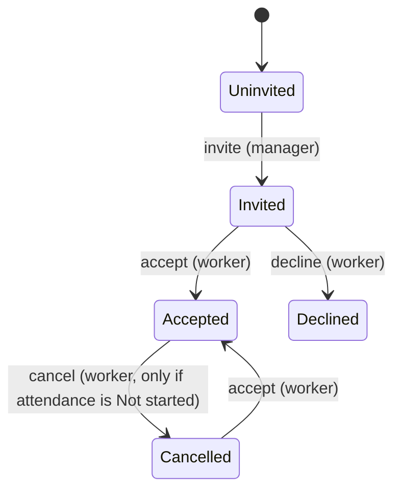
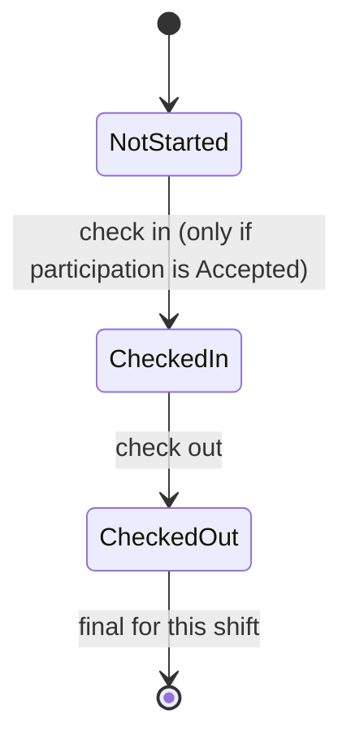
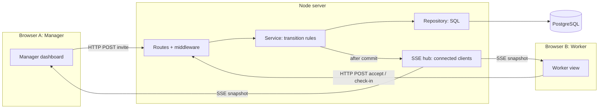
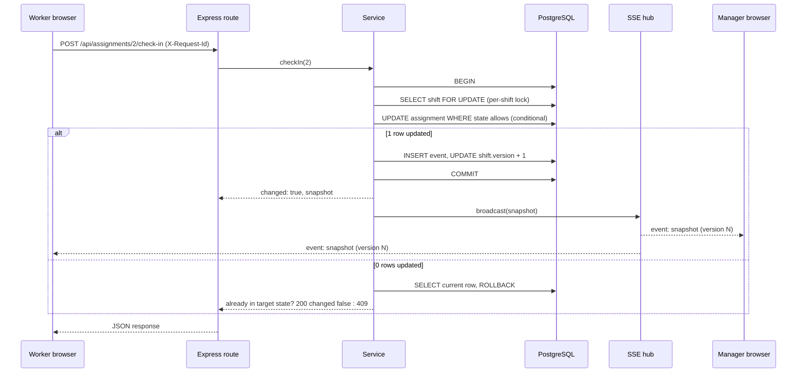
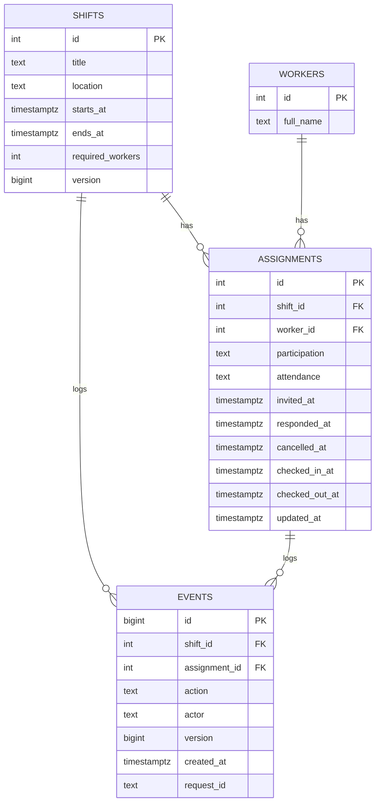

# Oloodi Coding Test: Cahier des charges

> **Planning note, written before the implementation (2026-11-08).** This is the author's own
> research and decision record, copied here unchanged apart from its links. The built system is
> described by the [README](../../README.md) and the [specification](../../specs/001-live-staffing-dashboard);
> where a detail differs, those and the code are current. The task list this note refers to is
> [tasks.md](../../specs/001-live-staffing-dashboard/tasks.md).

Live Staffing Dashboard. Version 1, 2026-11-08. Author: Ibrahim KASMI.
Related notes: the task tracker (now [tasks.md](../../specs/001-live-staffing-dashboard/tasks.md))

Legend used in this document:
- **[BRIEF]** comes directly from the Oloodi PDF or email.
- **[DECISION]** is my choice, with the reason next to it.
- **[ASSUMPTION]** fills a gap the brief leaves open. Each one is listed again in the README.

---

## 1. Context and goal

**[BRIEF]** An event manager needs three workers for a shift and sends assignment invitations. Workers accept or decline. Accepted workers check in on arrival and check out when they finish. The manager sees staffing and attendance changes live, without refreshing. A worker view and a manager dashboard run in separate browser sessions and stay consistent through one backend and one database.

**[BRIEF]** Deliverable: a repository link, sent by Monday 2026-11-09 EOD (timezone not stated; plan for Monday evening Rabat time). Then a 15 to 20 minute session: demo, code walkthrough, decisions, reliability, testing, challenges, AI use, and possibly a live change.

**Goal of this document:** fix every important decision before writing code, so the AI implements a spec I wrote and understand, not the other way around. This file is also the input for Spec Kit (constitution, spec, plan).

---

## 2. Evaluation criteria and how this project answers each

| Criterion **[BRIEF]** | What they will look for                      | How this project answers it                                                     |
| --------------------- | -------------------------------------------- | ------------------------------------------------------------------------------- |
| Code quality          | Readable, consistent, small files            | `routes → service → repository` layers, one transition table, one error format  |
| System design         | A design I can draw and defend               | Section 6 diagrams, section 15 decision records                                 |
| Reliability           | Retries, concurrency, reconnect, persistence | Conditional updates, per-shift lock, DB constraints, versioned snapshots, tests |
| Simplicity            | No big tool without a reason                 | No ORM, no auth, no queue, no Redis, no state library                           |
| Performance           | Real numbers, honestly measured              | Section 13 measurement protocol, in-app latency panel                           |
| Ownership of AI work  | Understanding every line, live change        | Spec Kit artifacts, AI log (section 17), rehearsed live change                  |

**Hidden test: the live change.** Likely requests: allow re-invite after Decline, make the shift need 4 workers, add a new action. Design so each is one row in the transition table plus one test, and capacity comes from data, not code.

---

## 3. Scope

### In scope **[BRIEF]**
- Seed: one shift (title, date, start and end time, location) requiring 3 workers, and 3 named workers, all Uninvited.
- Worker view: pick a worker, see the invitation, accept, decline, cancel, check in, check out.
- Manager dashboard: send invitations, shift details, each worker's two statuses, check-in and check-out timestamps, filled and remaining places, checked-in and checked-out counts.
- Live updates without refresh, persistence across refresh and restart, safe retries, useful errors, an offline indicator, automatic catch-up.
- Measurements of update delay and reconnection recovery time.
- Repository with setup and reset instructions, meaningful tests, concise README with the 5 required sections.

### Out of scope **[DECISION]**
- Login and authorization (the brief says login is not required).
- Multiple shifts in the UI (the schema supports them; the UI shows one).
- Hosting it publicly is optional (the brief asks for a repository and setup instructions). The app is still built **deployment-ready**: production Docker image, CI pipeline, server init and deploy scripts (section 22, phases 10 and 11).
- Offline queue that replays actions later. Actions made while offline fail clearly and are not saved.
- Email or push notifications, job queues, Redis, microservices.

---

## 4. Business rules

### 4.1 Two separate status dimensions **[BRIEF]**

| Dimension | Values | Initial |
|---|---|---|
| Participation | `uninvited`, `invited`, `accepted`, `declined`, `cancelled` | `uninvited` |
| Attendance | `not_started`, `checked_in`, `checked_out` | `not_started` |

Never merged into one field.

### 4.2 Participation state machine



### 4.3 Attendance state machine



Participation stays `accepted` during check-in and check-out **[BRIEF]**.

### 4.4 Transition table (the single source of truth in code)

| Action | Actor | Allowed from | Result | Timestamp set |
|---|---|---|---|---|
| `invite` | Manager | participation `uninvited` | participation `invited` | `invited_at` |
| `accept` | Worker | participation `invited` or `cancelled` | participation `accepted` | `responded_at` |
| `decline` | Worker | participation `invited` | participation `declined` | `responded_at` |
| `cancel` | Worker | participation `accepted` AND attendance `not_started` | participation `cancelled` | `cancelled_at` |
| `check_in` | Worker | participation `accepted` AND attendance `not_started` | attendance `checked_in` | `checked_in_at` |
| `check_out` | Worker | attendance `checked_in` | attendance `checked_out` | `checked_out_at` |

Everything not in this table is rejected. In code this is a plain object plus one pure function, `applyAction(state, action)`, which returns either the next state or an error. No XState: the table is small enough to read in one screen.

### 4.5 Counts **[BRIEF]**
- `filled` = number of assignments with participation `accepted` (includes checked in and checked out).
- `remaining` = `required_workers - filled`.
- `checkedIn` = attendance `checked_in` (currently on site).
- `checkedOut` = attendance `checked_out`.
- **[DECISION]** Counts are never stored. One shared function `deriveCounts(assignments)` computes them from the exact list sent to the client, so counts and list cannot disagree.

### 4.6 Assumptions for gaps in the brief **[ASSUMPTION]**

| # | Question | Choice | Why |
|---|---|---|---|
| A1 | Can the manager re-invite a Declined worker? | No | Checked against the PDF: the flow defines no transition out of Declined; the only "again" is "a Cancelled worker may accept again" (A5). I do not invent transitions. Easy to add (one row). See decisions log D7. |
| A2 | Can a Declined worker change their mind and accept? | No | Same reason. |
| A3 | Who cancels? | The worker | "An Accepted worker may cancel". |
| A4 | Can the manager withdraw an invitation? | No | Not defined. |
| A5 | Can a Cancelled worker be invited again? | No need: they can accept again directly | Brief: "a Cancelled worker may accept again". |
| A6 | What if accepting would exceed required places? | Rejected with `409 SHIFT_FULL` | Never triggers with 3 workers and 3 places, but keeps the rule correct if capacity or worker count changes. |
| A7 | What does repeating a successful action return? | `200` with `changed: false`, timestamps untouched | Makes retries safe. Section 7.3. |
| A8 | Offline actions | Fail with a clear message, not queued | Replay is not required and adds conflict cases. |
| A9 | Shift time vs check-in | Check-in allowed at any time | The brief sets no time window. The UI can warn but never blocks. |
| A10 | Seed date | Reset sets the shift to today, starting 2 hours after reset | The demo always looks realistic. |

---

## 5. Technology stack **[DECISION]**

| Layer | Choice | Why | Alternatives considered |
|---|---|---|---|
| Language | TypeScript (front and back) | One language, shared types for the snapshot and the transition table | JS (no type safety), Java (two languages) |
| Runtime | Node.js 22 LTS | See 5.1 | Spring Boot, Go, Python FastAPI |
| HTTP framework | Express 5 | Small, familiar, async errors reach the error middleware | NestJS (too much structure for 6 endpoints), Fastify (fine, less familiar) |
| Database | PostgreSQL 16 | Constraints, transactions, row locks, conditional updates | SQLite (fallback if Docker fails), MongoDB (weaker for relational rules) |
| DB access | `pg` driver with plain SQL | The SQL that makes transitions safe stays visible | Prisma, TypeORM, Drizzle, Knex |
| Validation | `zod` at the route boundary | Small, typed, one schema per route | Hand-written checks, Joi |
| Logging | `pino` + `pino-http` | Structured JSON logs with a request id | `console.log`, Winston |
| Security middleware | `helmet` (headers, CSP) + `express-rate-limit` on POST routes | Small, standard, covers XSS defence in depth and basic abuse | Hand-written headers, a reverse-proxy-only setup |
| API contract | Shared zod schemas and TS types; OpenAPI generated from them with `@asteasolutions/zod-to-openapi` (P2) | One source of truth, compile-time checks between client and server, docs that cannot drift | Hand-written OpenAPI (drifts), no docs beyond the README |
| Live updates | Native SSE (`EventSource`) | One-way server to browser is all we need, built into browsers | WebSockets, Socket.IO, polling |
| Frontend | React 18 + Vite | Fast dev setup, no SSR needed | Next.js, Vue, plain HTML |
| Styling | Tailwind CSS with design tokens in the Tailwind theme | Consistent spacing, colours and states with little CSS; tokens match the Claude Design system page | Plain CSS (fallback), CSS modules, full component libraries like MUI (heavy, generic look) |
| UI components | 4 or 5 copied components from beUI (MIT): Timeline, Animated Toast Stack, Action Swap, Animated Collapsible, Animated Alert | Polished, accessible building blocks for the creative features; the source lives in the repo, so I own and can edit every line | Writing them from scratch (slower), installing a whole UI kit (unused code) |
| Motion | Motion (formerly Framer Motion), only through those components | Short, purposeful transitions: KPI number pop-in, new timeline items, action swap; respects `prefers-reduced-motion` | CSS transitions only (fallback), no motion |
| Unit and API tests | Vitest + Supertest against real Postgres | Tests the real SQL, not mocks | Jest, mocked DB |
| E2E tests | Playwright, two browser contexts | Real separate sessions, one shared clock | Cypress (single-tab focus) |
| Infra | Docker Compose (Postgres, and the app for reviewers) | One-command setup | Local Postgres install, cloud |
| Spec process | Spec Kit | Spec, plan, tasks written before code; evidence of directing the AI | Ad hoc prompting |

### 5.1 Why Node.js here
1. **Same language as the frontend.** Shared types for the snapshot, the actions and the counts function. One `deriveCounts` used everywhere.
2. **Good at holding many open connections.** SSE keeps one long-lived connection per open screen. Node's event loop holds idle connections cheaply, without one thread per connection.
3. **Small and explicit.** About 6 endpoints, one stream, three tables. Express plus `pg` is a few hundred lines with nothing hidden.
4. **My experience and Oloodi's stack.** I have used Node at Smilycall, and Oloodi listed Node and TypeScript.

Honest tradeoff: Spring Boot would also work (I know it from ZenithSoft, and `SseEmitter` exists), but it means two languages and more boilerplate for a tiny app. Node is not required by the brief; it is the simplest good fit.

---

## 6. Architecture

### 6.1 Overview



Direction rule: **browser → server is HTTP**, **server → browser is SSE**.

### 6.2 Layers and responsibilities

| Layer | File(s) | Does | Does not |
|---|---|---|---|
| Routes | `routes.ts` | Parse and validate input, call the service, send the response | Business rules, SQL |
| Middleware | `middleware/*.ts` | Request id, logging, JSON limit, no-store headers, error mapping | Business rules |
| Service | `service.ts`, `domain/transitions.ts` | Run the transaction, apply the transition table, decide idempotent vs conflict | HTTP details |
| Repository | `repository.ts` | SQL queries, nothing else | Rules |
| SSE hub | `sse.ts` | Track connections, send snapshots and heartbeats | Business rules |
| Shared | `shared/types.ts`, `shared/counts.ts`, `shared/transitions.ts` | Types and pure functions used by both sides | IO |

### 6.3 Action flow (example: worker checks in)



### 6.4 Folder structure

```
live-staffing/
  docker-compose.yml
  README.md
  AI_LOG.md
  specs/                  (Spec Kit output)
  db/
    schema.sql
    roles.sql
    seed.sql
  shared/
    types.ts
    transitions.ts        (table + applyAction)
    counts.ts             (deriveCounts)
  server/
    src/
      app.ts              (express setup, middleware order)
      routes.ts
      service.ts
      repository.ts
      sse.ts
      errors.ts
      middleware/
      demo.ts             (chaos endpoints, only when DEMO_MODE=true)
    test/
  web/
    src/
      api.ts              (fetch wrapper: timeout, retry, request id)
      live.ts             (EventSource + watchdog + version guard)
      pages/Manager.tsx
      pages/Worker.tsx
      components/
  e2e/
    staffing.spec.ts
    measure.spec.ts
```

---

## 7. Data model

### 7.1 Entity relationship



**[DECISION]** One assignment row per worker per shift is created by the seed with `uninvited`. Inviting is then an `UPDATE`, like every other action. One code path, and the unique constraint makes duplicates impossible.

### 7.2 Constraints (the database refuses impossible rows)

```sql
-- shifts
CHECK (ends_at > starts_at)
CHECK (required_workers > 0)

-- assignments
UNIQUE (shift_id, worker_id)
FOREIGN KEY (shift_id) REFERENCES shifts(id)
FOREIGN KEY (worker_id) REFERENCES workers(id)
CHECK (participation IN ('uninvited','invited','accepted','declined','cancelled'))
CHECK (attendance IN ('not_started','checked_in','checked_out'))
-- attendance can only move if the worker is Accepted
CHECK (attendance = 'not_started' OR participation = 'accepted')
-- timestamps match attendance
CHECK (
  (attendance = 'not_started' AND checked_in_at IS NULL AND checked_out_at IS NULL) OR
  (attendance = 'checked_in'  AND checked_in_at IS NOT NULL AND checked_out_at IS NULL) OR
  (attendance = 'checked_out' AND checked_in_at IS NOT NULL AND checked_out_at IS NOT NULL
                              AND checked_out_at >= checked_in_at)
)
```

Note: the "attendance only if Accepted" check also blocks cancelling after check-in at the database level.

### 7.3 Transactions, concurrency and idempotency

Every action runs this in one transaction:

1. `SELECT ... FROM shifts WHERE id = $1 FOR UPDATE`. Locks the shift row, so changes to one shift happen one at a time. This makes `version` follow commit order and makes the capacity check (A6) safe. Other shifts are not blocked.
2. Conditional update, for example:
   ```sql
   UPDATE assignments
   SET attendance = 'checked_in', checked_in_at = now(), updated_at = now()
   WHERE id = $1 AND participation = 'accepted' AND attendance = 'not_started'
   RETURNING *;
   ```
3. If 1 row: insert the event, increment `shifts.version`, commit, broadcast.
4. If 0 rows: read the current row and decide:
   - Already in the target state (for example already `checked_in`): **`200`, `changed: false`**, original timestamp kept.
   - Otherwise (for example `checked_out`, or `declined` trying to check in): **`409 INVALID_TRANSITION`** with the current state.
   - Row not found: **`404`**.

Why not "read, check in JavaScript, then write": two requests can both read `not_started` before either writes, and both would succeed. The conditional `WHERE` plus the lock prevents that.

### 7.4 Least privilege in the database

| Role | Can | Cannot |
|---|---|---|
| `staffing_owner` | Create schema, run reset and seed | Used only by scripts |
| `staffing_app` | `SELECT, UPDATE` on `shifts`, `assignments`; `SELECT, INSERT` on `events`; `SELECT` on `workers` | `DELETE`, `DROP`, DDL, updating or deleting events |

Result: the running app cannot delete data or rewrite history; the events table is append-only by permission, not just by convention. Plus: Postgres port bound to `127.0.0.1` only, and the app container runs as a non-root user.

---

## 8. API contract

Base path `/api`. All responses JSON, `Cache-Control: no-store`.

| Method | Path | Who | Purpose |
|---|---|---|---|
| GET | `/api/state` | Both | Current snapshot |
| GET | `/api/events` | Both | SSE stream; first event is always a full snapshot |
| POST | `/api/assignments/:id/invite` | Manager | Invite |
| POST | `/api/assignments/:id/accept` | Worker | Accept |
| POST | `/api/assignments/:id/decline` | Worker | Decline |
| POST | `/api/assignments/:id/cancel` | Worker | Cancel |
| POST | `/api/assignments/:id/check-in` | Worker | Check in |
| POST | `/api/assignments/:id/check-out` | Worker | Check out |
| GET | `/api/health` | Ops | Server and DB health |
| POST | `/api/demo/burst` | Demo | Fire 10 parallel identical actions (DEMO_MODE only) |
| POST | `/api/demo/outage?seconds=5` | Demo | Drop all SSE connections and refuse new ones for N seconds (DEMO_MODE only) |

### 8.1 Success response
```json
{ "changed": true, "snapshot": { "...": "see section 9" } }
```

### 8.2 Error response (one format everywhere)
```json
{
  "error": {
    "code": "INVALID_TRANSITION",
    "message": "Cannot check in: this worker has already checked out.",
    "current": { "participation": "accepted", "attendance": "checked_out" }
  },
  "requestId": "b1f3..."
}
```

| Code | HTTP | When |
|---|---|---|
| `VALIDATION_ERROR` | 400 | Bad id or parameter |
| `NOT_FOUND` | 404 | Assignment does not exist |
| `INVALID_TRANSITION` | 409 | Action not allowed from the current state |
| `SHIFT_FULL` | 409 | Accept would exceed required places (A6) |
| `INTERNAL` | 500 | Unexpected; logged with request id, details not leaked |

### 8.3 Input validation
`zod` schema per route: `id` must be a positive integer; the action comes from the route itself so unknown actions are a 404. Body is not used. JSON body limit 10kb.

### 8.4 Middleware order
1. `requestId`: reuse `X-Request-Id` from the client or generate one; echo it in the response.
2. `pino-http`: one log line per request with id, method, path, status, duration.
3. `helmet`: security headers and CSP (8.5).
4. `express-rate-limit` on POST routes only (SSE and GET stay unlimited).
5. `express.json({ limit: '10kb' })`.
6. `noStore`: `Cache-Control: no-store` on `/api`.
7. Routes (with `zod` validation).
8. 404 handler.
9. Error handler: maps domain errors to the table above, logs 500s with the stack.

### 8.5 Security **[DECISION]**

| Risk | Handling |
|---|---|
| SQL injection | Every query uses `pg` placeholders (`$1`, `$2`); no SQL built from strings anywhere. zod (id is a positive integer) is a second layer, not the protection. The `staffing_app` role limits damage (7.4). Test: `1; DROP TABLE workers` as id returns 400. |
| XSS | React escapes all rendered values. No `dangerouslySetInnerHTML`, including inside copied beUI components. Users never type free text (names come from the seed). Deep-link `worker` id validated against the known list. `helmet` CSP: `default-src 'self'`, `connect-src 'self'`. |
| CSRF | No cookies or sessions, so nothing to hijack. API and web served from one origin in production; no `cors()` with `*`. |
| No authentication | By design (**[BRIEF]** login not required). Listed under README limitations: anyone with the URL can act as any worker. |
| Abuse / DoS | 10 kb body limit, rate limit on POST routes, cap on concurrent SSE clients (reject with 503 above the cap). |
| Demo endpoints | Mounted only when `DEMO_MODE=true`; off by default in production. |
| Error leaks | Responses carry only `{error:{code,message,current},requestId}`; stack traces go to pino logs. |
| Dependencies | Lockfile committed, `npm audit --omit=dev` in CI, non-root Docker image. |
| Secrets | `.env` git-ignored, `.env.example` committed, config validated at startup, Postgres bound to `127.0.0.1`. |

### 8.6 API documentation **[DECISION]**
- **Now (P0):** request and response types live in `shared/` and are imported by both client and server, so a contract mismatch fails at compile time. The README has the endpoint table and error codes.
- **Later (P2):** generate `openapi.json` from the same zod schemas with `@asteasolutions/zod-to-openapi` and serve it at `/api/docs`. Never hand-written, so it cannot drift from the code.
- Why not more: about 11 endpoints, 6 of them the same action pattern; shared types give more safety than docs alone at this size.

---

## 9. Snapshot shape (what every client receives)

```ts
type Snapshot = {
  version: number;          // shifts.version, increases with every committed change
  serverTime: string;       // ISO time when the snapshot was built
  shift: { id; title; location; startsAt; endsAt; requiredWorkers };
  assignments: Array<{
    id; worker: { id; fullName };
    participation; attendance;
    invitedAt; respondedAt; cancelledAt; checkedInAt; checkedOutAt;
  }>;
  counts: { filled; remaining; checkedIn; checkedOut; invited; declined; cancelled; uninvited };
  recentEvents: Array<{ id; action; workerName; actor; at; version }>; // last 20
};
```

**[DECISION] DTOs:** the zod schema plus its inferred TypeScript type is the DTO; no NestJS-style DTO classes. One mapper in the repository layer (`toSnapshot`) turns DB rows into this type: `snake_case` to `camelCase`, timestamps to ISO strings. Raw rows never reach the client. Every field above is used by the UI (the brief asks for the timestamps on the dashboard; event ids are React keys for the timeline). Internal columns such as `updated_at` are not sent.

**[DECISION]** Always send the full snapshot, not small diffs. It is tiny (3 rows) and removes a whole class of "missed event" bugs. With thousands of rows I would switch to diffs plus a version gap check.

---

## 10. Live updates and reconnect

### 10.1 Server (SSE)
- Headers: `Content-Type: text/event-stream`, `Cache-Control: no-store`, `Connection: keep-alive`.
- On connect: register the client, **then** send `event: snapshot` with the current data. Registering first means no change can slip between "read snapshot" and "start listening".
- `retry: 2000` so the browser waits 2 seconds before reconnecting.
- After each commit: build one snapshot and send it to every client.
- Heartbeat: `event: ping` every 15 seconds. A named event, not a comment line, because comment lines are invisible to `EventSource` and the client watchdog needs to see them.
- On close: remove the client.

### 10.2 Client
- `live.ts` wraps `EventSource` and exposes `status: 'live' | 'reconnecting' | 'offline'`, `lastSyncedAt`, `snapshot`.
- **Version guard:** apply a snapshot only if `version > current.version`. Used for SSE snapshots and HTTP action responses alike, so an older response can never overwrite newer state.
- **Watchdog:** if nothing (snapshot or ping) arrives for 35 seconds, close and reconnect manually. Catches dead connections the browser does not notice.
- **Closed stream:** if the server answers with an error status (for example 503 during an outage), `EventSource` stops for good. The client then reconnects itself with backoff: 1s, 2s, 4s, max 10s.
- On every (re)connect the first event is a full snapshot, so catch-up is automatic.

### 10.3 Honest limits
- SSE does not guarantee delivery. If a broadcast is lost after a commit, the client is stale until the next snapshot or reconnect. The watchdog and heartbeat bound how long.
- The SSE hub lives in one process. Two server instances would need PostgreSQL `LISTEN/NOTIFY` to share changes (future improvement, no Redis needed).
- Browsers allow about 6 HTTP/1.1 connections per site. Many tabs on the same site can block SSE. Demo with separate browser profiles or windows, not 8 tabs.

---

## 11. Client behaviour: retries, errors, sessions

### 11.1 Retry policy for actions
| Situation | Behaviour |
|---|---|
| Request in flight | Button disabled with a spinner; no double submit |
| Network error or timeout (8s, `AbortController`) | Retry up to 2 times after 300ms and 1s. Safe because every action is idempotent |
| `5xx` | Same retry policy |
| `4xx` (400, 404, 409) | No retry. Show the message; refresh to the current snapshot from the response |
| All retries failed | Toast: "Couldn't reach the server. Nothing was saved. Try again." |

**Nothing is saved locally.** No localStorage, no offline queue, no replay later (A8). The last known state is kept in memory only, for display. The database is the only source of truth.

**Lost response case:** the server commits, the response is lost, the client retries. The server sees the worker already in the target state and returns `200 changed: false` with the original timestamp, so the UI shows "Already checked in at 14:02". No duplicate row, no changed timestamp.

### 11.2 Feedback
- Success: brief confirmation ("Checked in at 14:32").
- `changed: false`: quiet info ("Already checked in at 14:32"), not an error.
- `409`: explain what happened ("This worker already checked out, so they can't check in again").
- Offline: banner on every screen while the stream is down; actions still allowed but may fail clearly.

### 11.3 Two sessions for the same worker
- Both tabs subscribe to the stream and receive the same snapshots.
- If both act at once, the per-shift lock serializes them. One succeeds; the other gets `200 changed: false` (same action) or `409` (conflicting action) and refreshes from the response.
- When a snapshot changes the selected worker's state and it was not this tab's own action, show "Updated from another session".

### 11.4 Caching
No caching layer. **[DECISION]** The data is 3 rows read from an indexed table; a cache would only add a way to show stale data, which is exactly what this app must avoid. API responses are `no-store`. Static frontend files are cached normally.

---

## 12. Screens and UX

### 12.1 Manager dashboard (desktop first)
- Header: shift title, date, start and end time, location, live health badge.
- KPI row: Filled x/3, Remaining, Checked in now, Checked out.
- Readiness line in plain words.
- Worker table: name, participation badge, attendance badge, invited at, responded at, checked in at, checked out at, action (Invite only when Uninvited).
- Activity timeline on the side.
- Measurement panel (collapsible).
- Demo controls (only in demo mode).

### 12.2 Worker view (mobile first)
- Worker selector at the top; deep link `/worker/:id`.
- Shift card: title, date, time, location.
- Current status shown in words for both dimensions.
- Exactly the allowed action buttons for the current state (from the transition table), large and thumb-friendly.
- Recorded timestamps.
- Health badge, toasts.

### 12.3 Visual rules
- Participation and attendance use **different visual encodings** (for example participation as filled pills, attendance as outlined chips with an icon), so nobody confuses them.
- Status always has text, never colour alone.
- Accessible contrast, visible focus, buttons at least 44px tall on mobile.

---

## 13. Creative features (all, with priority)

| # | Feature | What it does | Benefit | Priority |
|---|---|---|---|---|
| C1 | Live health badge | "● Live", "Reconnecting…", "Offline, data from 14:32", last synced time, snapshot version | Covers the "indicate when live updates are unavailable" rule and builds trust | P0 |
| C2 | Chaos demo controls | "Spam check-in ×10" and "Simulate outage 5s" (DEMO_MODE only) | Proves retry safety and recovery live in 30 seconds | P1 |
| C3 | Live measurement panel | Shows delay from server commit to screen for recent updates, and the last recovery time | Turns performance claims into something visible during the demo | P1 |
| C4 | Activity timeline | "14:02 Amina accepted · 14:31 Amina checked in", from the append-only events table | History at a glance; shows each change and its log entry commit together | P1 |
| C5 | Readiness hint | "2 of 3 places filled · starts in 3h · 1 still invited"; warning if the shift started and someone accepted has not checked in | Manager sees what needs attention; pure derived display, no new status | P2 |
| C6 | Mobile-first worker view | Big buttons, one clear action at a time | Workers check in from their phones | P1 |
| C7 | "Updated from another session" notice | Shown when another tab changed this worker | Makes multi-session behaviour visible and understandable | P2 |
| C8 | Worker deep links + copy link | `/worker/2`, copy button on the manager row | Faster demo: open a worker in another browser in one click | P2 |

Rejected on purpose: a single page showing every worker at once (SSE connection limit), sounds, heavy animations, dark mode polish. They cost time and do not serve the graded criteria.

---

## 14. Testing plan

### 14.1 Unit (Vitest, pure)
- Every allowed transition in the table produces the right next state.
- Every disallowed pair is rejected (generated from the table, so new rows are tested automatically).
- `deriveCounts` on mixed states: checked out still counts as filled.

### 14.2 API against real Postgres (Vitest + Supertest)
- Happy path: invite → accept → check in → check out.
- Illegal actions: check in while invited, check out before check in, cancel after check in, accept after decline.
- Cancel then accept again.
- Checkout is final: check in after checkout is `409`.
- Repeated check-in returns `200 changed: false` and the same `checked_in_at`.
- Concurrency: 10 parallel check-ins → exactly one `changed: true`, one event row, one timestamp.
- Concurrency: parallel cancel and check-in → exactly one wins, the database stays valid.
- Database constraint test: a direct invalid `UPDATE` is refused by Postgres.
- Persistence: state survives a server restart.

### 14.3 End to end (Playwright)
- Manager and worker in two browser contexts: invite appears in the worker view without refresh; accept appears in the manager view without refresh; counts match the list.
- Refresh keeps statuses and timestamps.
- Outage: trigger `/api/demo/outage?seconds=5`, change state through the API during the outage, check the banner appears, then check the dashboard catches up to the change without refresh.

---

## 15. Measurement protocol

| Metric | Exact definition | How | Samples |
|---|---|---|---|
| Update delay (end to end) | From the worker's click to the change being visible in the manager's page | Playwright, both contexts in one process, same clock | 20 runs, median and max |
| Update delay (server to screen) | From server commit time to the client applying the snapshot | Measurement panel; same machine so clocks match | Shown live |
| Reconnection recovery time | From the outage ending to the manager page showing the correct current snapshot | Playwright with `/api/demo/outage` | 20 runs, median and max |

Report the machine, OS, browser, and whether it ran in Docker. Explain that recovery time is mostly the configured retry delay (2s and backoff), so it is a design choice, not just raw speed. No invented numbers.

---

## 16. Architecture decision records (short)

| # | Decision | Why | Tradeoff accepted |
|---|---|---|---|
| ADR1 | SSE over WebSockets | One-way updates, native, auto reconnect, plain HTTP | No client-to-server channel (not needed; HTTP does that) |
| ADR2 | Full snapshot on connect and on every change | Tiny data, no missed-event bugs, catch-up for free | Wasteful at large scale; would move to diffs plus versions |
| ADR3 | Per-shift row lock + conditional updates | Correct under concurrency, ordered versions | Changes to one shift are serialized (fine at this scale) |
| ADR4 | Derived counts, never stored | Cannot drift from the list | Recomputed on each snapshot (3 rows, negligible) |
| ADR5 | Plain SQL, no ORM | Visible, explainable safety logic | A bit more manual mapping |
| ADR6 | No queue, no Redis, no auth | Not required; each adds failure modes | Single instance only; documented scaling path |
| ADR7 | Idempotent repeats return 200 | Safe client retries, simple UX | Need a clear "already done" vs "impossible" rule |
| ADR8 | Seeded `uninvited` rows | Invite is an UPDATE like every other action | Rows exist before invitation |
| ADR9 | Tailwind + Motion + a few copied beUI components | Fast, consistent, polished UI for the creative features, with the source in the repo | Two extra frontend dependencies; limited to the components actually used, animations only on opacity and transform, reduced-motion respected |
| ADR10 | zod schemas in `shared/` are the API contract; OpenAPI generated from them (P2) | One source of truth for validation, types and docs | A generator dependency if OpenAPI is added; until then the README table is the human-readable contract |
| ADR11 | No offline storage or queue for actions | The database is the only truth; the user is never told something was saved when it was not | Actions made while offline must be redone by hand |

---

## 17. AI usage and ownership

- Spec Kit artifacts in `specs/`, written from this document. I write the constitution principles myself.
- `AI_LOG.md`, short entries:
  - What I asked (tool: Claude, Codex, Spec Kit).
  - What it produced.
  - What I changed or rejected, and why.
  - How I verified it (test name, manual check).
- Rule: no generated code is committed until I have read it and a test covers it.
- Rehearse one live change before the call (for example allow re-invite after Decline: one table row, one test, one constraint check).

---

## 18. Delivery

### 18.1 Commands (target)
```bash
docker compose up --build          # reviewers: everything, app on http://localhost:3000
npm run db:reset                   # drop, recreate, seed (owner role)
npm run dev                        # dev: server + web with hot reload, db in docker
npm test                           # unit + API tests
npm run e2e                        # Playwright
npm run measure                    # measurement runs, prints median and max
```

### 18.2 Git
- Coherent commits, conventional style (`feat:`, `test:`, `fix:`, `docs:`).
- One main branch is enough; a single PR or direct commits, explained in the README.

### 18.3 README sections **[BRIEF]**
1. Architecture and design
2. Technology choices
3. Testing and measurements
4. Challenges and learnings
5. Limitations and improvements
Plus setup, reset, assumptions list, demo mode.

---

## 19. Demo script (15 to 20 minutes)

1. (1 min) What the app does, the two status dimensions.
2. (4 min) Live demo: manager invites, worker accepts in another browser, check in, check out; counts update live; refresh keeps everything.
3. (2 min) Reliability live: spam ×10, outage and recovery, with the measurement panel.
4. (5 min) Code walk: transition table → service transaction → SQL conditional update → constraints → SSE hub → client version guard.
5. (3 min) Tests and measurements.
6. (3 min) AI use: what I accepted, what I corrected, what I learned.
7. Live change if asked.

---

## 20. Time plan

| When | Work |
|---|---|
| Sun afternoon | Spec Kit (1h max), scaffold, schema, roles, seed, transition table + unit tests |
| Sun evening | Service + repository + routes, API tests including concurrency |
| Mon morning | SSE hub, client live layer, manager and worker screens |
| Mon afternoon | Playwright tests, creative P1 features, measurements |
| Mon evening | README, AI log, final run from a clean clone, send the link |

Cut order if late: C5, C7, C8 first, then C3. Never cut tests or the health badge.

---

## 21. Open questions

- Deadline timezone ("Monday EOD" not specified). Plan for Monday evening Rabat time.
- Whether a hosted demo is expected (not asked). The app is deployment-ready either way; actually hosting it is a bonus, done only if time allows.

---

## 22. Task list

The full task list and the progress tracker live in the task tracker (now [tasks.md](../../specs/001-live-staffing-dashboard/tasks.md)), so there is one list to tick.

Questions, clarifications and final decisions are recorded in [the decisions log](decisions-log.md).
